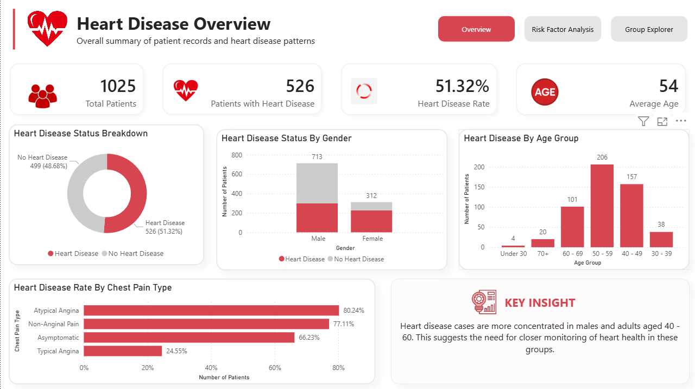
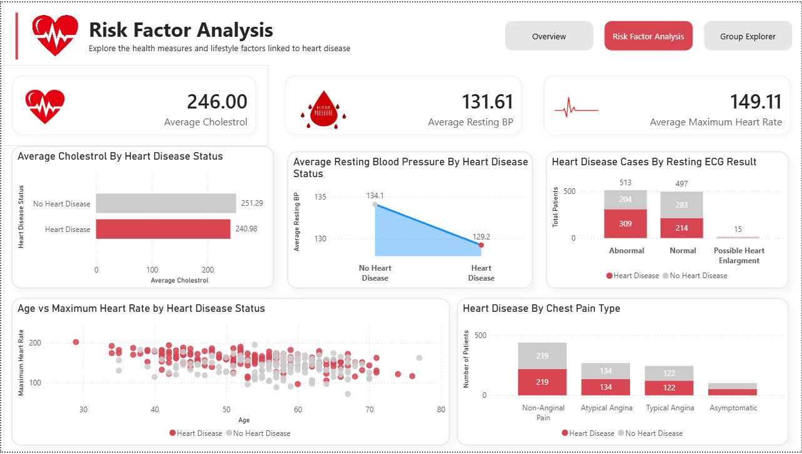
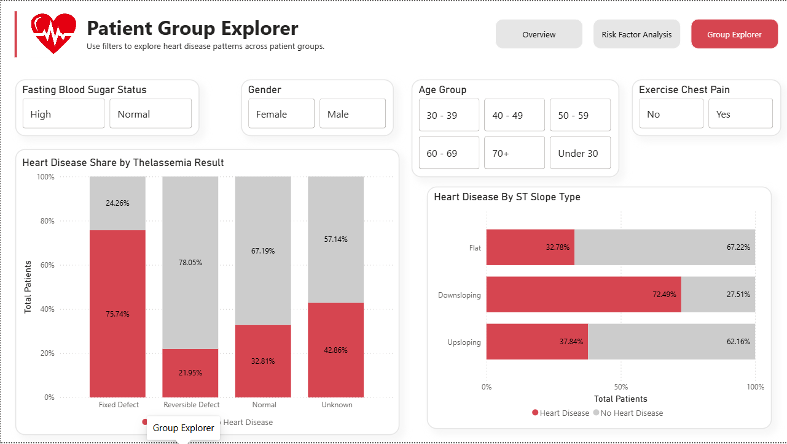
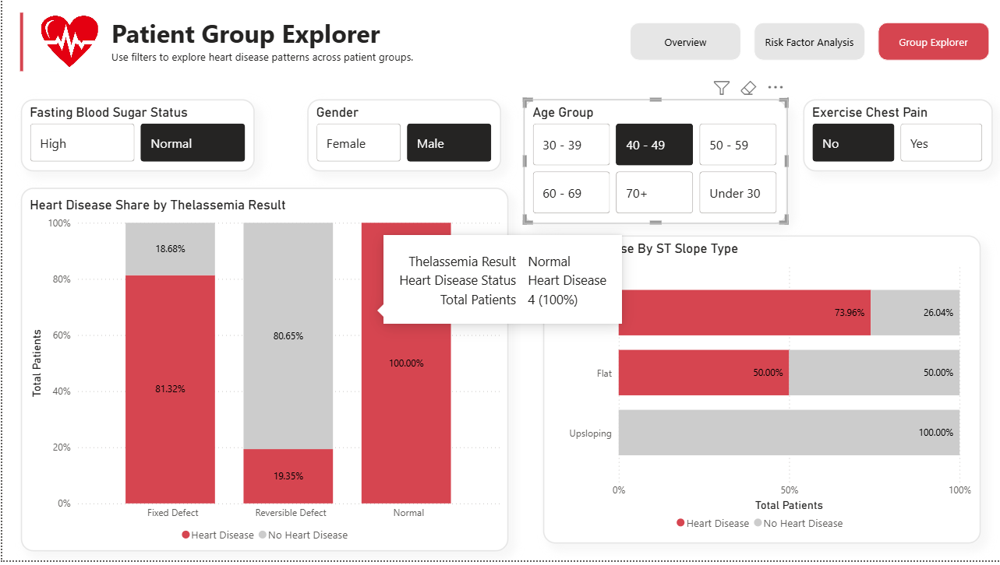
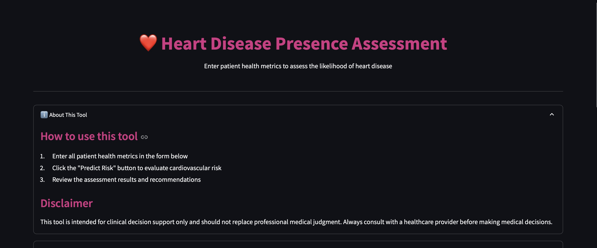
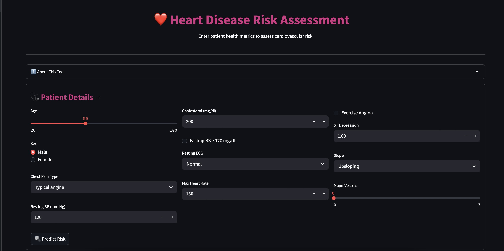
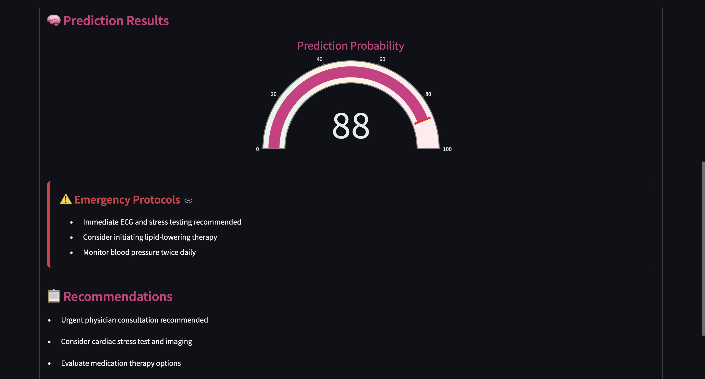

# Cardio-Risk Predictor: Heart Disease Analytics & Prediction

This project combines **Power BI analytics** and **machine learning** to explore heart disease patterns and predict whether heart disease is present in a patient record.

The project uses the **[Heart Disease Dataset on Kaggle](https://www.kaggle.com/datasets/johnsmith88/heart-disease-dataset/data)**. The dataset contains patient health information such as age, gender, chest pain type, blood pressure, cholesterol, maximum heart rate, ECG results, and heart disease status.

---

## Project Overview

This is a full analytics and machine learning project with two main parts:

1. **Power BI Dashboard**  
   Used to explore heart disease patterns, compare patient groups, and understand key risk indicators.

2. **Machine Learning Model**  
   Used to train and evaluate models that predict whether heart disease is present.

---

## Power BI Dashboard

The Power BI dashboard has three pages:

### 1. Overview

This page gives a high-level summary of the dataset, including total patients, heart disease cases, heart disease rate and average age.



---

### 2. Risk Factor Analysis

This page explores key health readings and symptoms such as cholesterol level, resting blood pressure, maximum heart 
rate and chest pain type



---

### 3. Test Patterns

This page focuses on test-related patterns such as ST slope type and thalassemia result. It also includes filters 
for exploring patient groups.
                                      




---

## 🧠 Machine Learning

Several models were trained and compared:

- Logistic Regression
- Support Vector Machine
- K-Nearest Neighbors
- Random Forest Classifier
- Decision Tree Regressor
- Random Forest Regressor

The **Random Forest Classifier** was selected as the main model because it gave the best overall performance for predicting heart disease status.

---

## 🔄 Workflow

The project followed this process:

1. Loaded and prepared the dataset
2. Cleaned and renamed columns for easier understanding
3. Explored the data using Power BI
4. Built a 3-page interactive dashboard
5. Trained and tested multiple machine learning models
6. Selected the best-performing model
7. Built a Streamlit app for prediction

---

## ✅ Key Features

- Interactive Power BI dashboard
- Cleaned and renamed dataset columns
- DAX measures for KPIs and patient counts
- Visual analysis of heart disease patterns
- Machine learning model training and evaluation
- Streamlit app for heart disease prediction
- Docker support

---

## 🖼️ Streamlit App Screenshots

### App Guide



---

### User Input Form



---

### Prediction Output



---

## 🛠️ Tech Stack

- Python
- pandas
- numpy
- scikit-learn
- xgboost
- matplotlib
- seaborn
- Power BI
- Streamlit
- Docker
- Git and GitHub

---

## 🚀 How to Run the Project

### 1. Clone the repository

```bash
git clone https://github.com/Ekuaappiah/cardio-risk-predictor.git
cd cardio-risk-predictor
````

### 2. Create and activate a virtual environment

```bash
python3 -m venv venv
source venv/bin/activate      # macOS/Linux
venv\Scripts\activate         # Windows
```

### 3. Install dependencies

```bash
pip install -r requirements.txt
```

### 4. Run the model pipeline

```bash
python heart_disease_pipeline.py
```

### 5. Run the Streamlit app

```bash
streamlit run app.py
```

The app will open at:

```text
http://localhost:8501
```

---

## 🐳 Docker

Build the Docker image:

```bash
docker build -t heart-disease-predictor .
```

Run the container:

```bash
docker run -it --rm heart-disease-predictor
```


## Author

**Emmanuella Appiah**
[LinkedIn](https://www.linkedin.com/in/emmanuella-appiah-16a215213)

---

## License

This project is licensed under the [MIT License](LICENSE).

```
```
